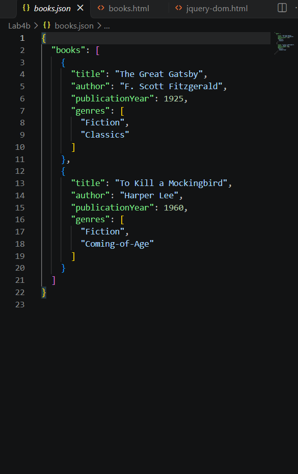
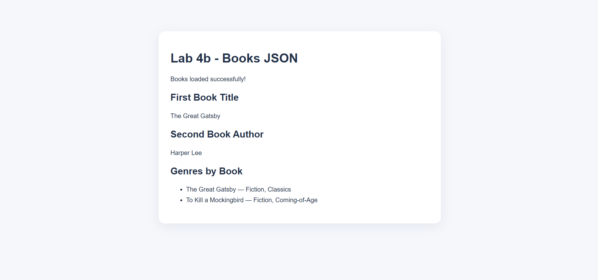
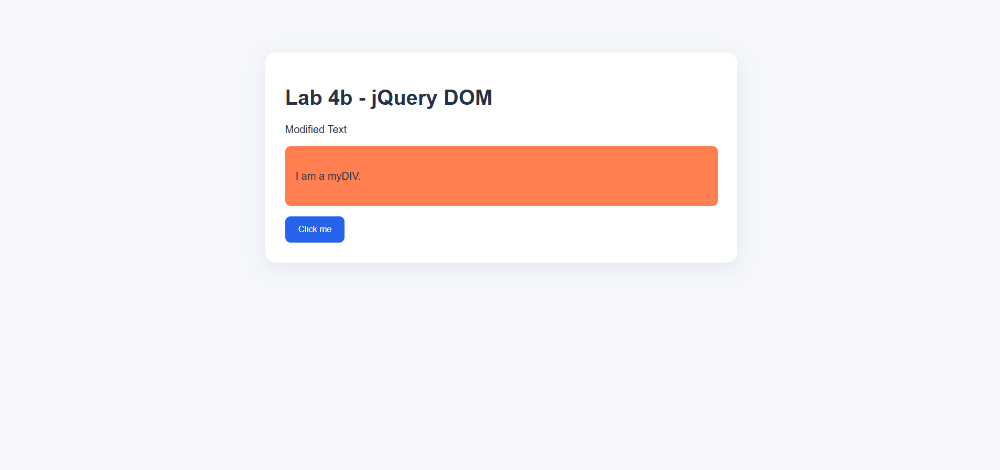
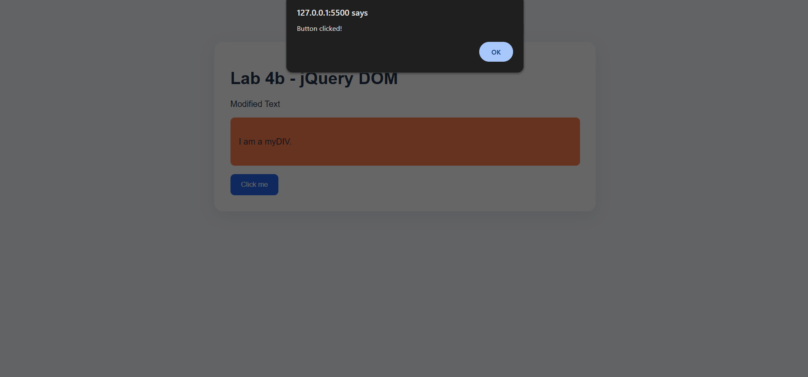

# BIC21203 Web Development — Lab 4b

## Client-Side Scripting (JSON and jQuery)

**Student:** Khong Jia Yi  
**Student ID:** AI240176  
**Course:** BIC21203 Web Development  
**Academic Session:** 2026/2027

## Description

This lab focuses on JSON data handling, JavaScript `fetch()` and jQuery. It demonstrates how to create JSON data, retrieve information from a JSON file and manipulate HTML elements using jQuery.

## How to Run

1. Download or clone this repository.
2. Open the project folder in Visual Studio Code.
3. Install the Live Server extension by Ritwick Dey.
4. Open `books.html` using Live Server to test JSON data retrieval.
5. Open `jquery-dom.html` using Live Server to test jQuery.
6. Ensure an internet connection is available to load the official jQuery 4.0.0 CDN.

## Tasks

### Question 1 — Create and Structure JSON Data

- Create a file named `books.json`.
- Store two books in a top-level `books` array.
- Include the title, author, publication year and genres.
- Use valid JSON syntax and correct data types.

### Question 2 — Retrieve and Display JSON Data

- Use `fetch()` to retrieve data from `books.json`.
- Display the first book's title.
- Display the second book's author.
- Display the genres of both books.
- Handle unsuccessful requests and invalid JSON.

### Question 3 — Compare Native JavaScript and jQuery

- Use `.text()` to change the text to "Modified Text".
- Use `.addClass()` to apply the `myStyle` CSS class.
- Use `.on("click", ...)` to display the "Button clicked!" alert.
- Use the official jQuery 4.0.0 CDN.

## Test Evidence

The following screenshots demonstrate the execution of all three questions. Add screenshots at the paths below before submission.

### Question 1 — JSON Data

### Question 2 — JSON Data Retrieval

### Question 3 — jQuery DOM Manipulation

## Native JavaScript vs jQuery

Native JavaScript does not require an additional library and works directly in modern browsers.

jQuery can still be useful for maintaining existing projects that already use jQuery plugins and code.

## Conclusion

This lab helped me understand how to create and retrieve JSON data using JavaScript. I also learned how to use jQuery methods to update HTML elements, apply CSS classes and handle button clicks.
